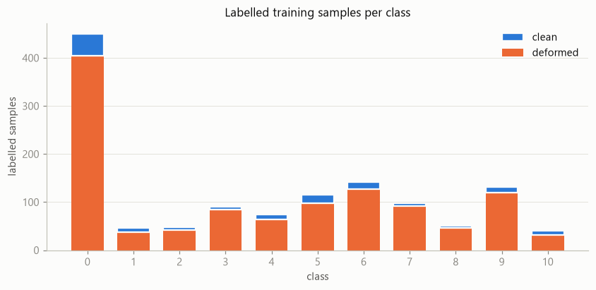
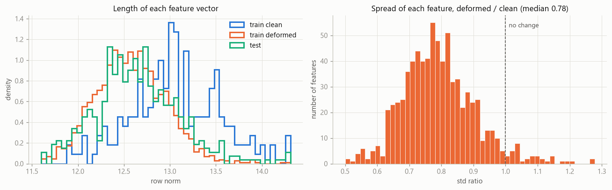
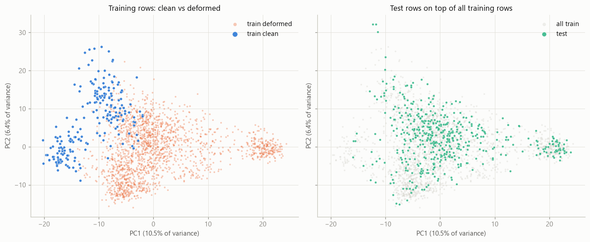
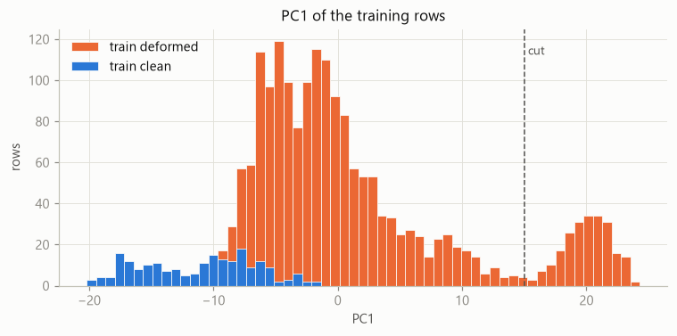
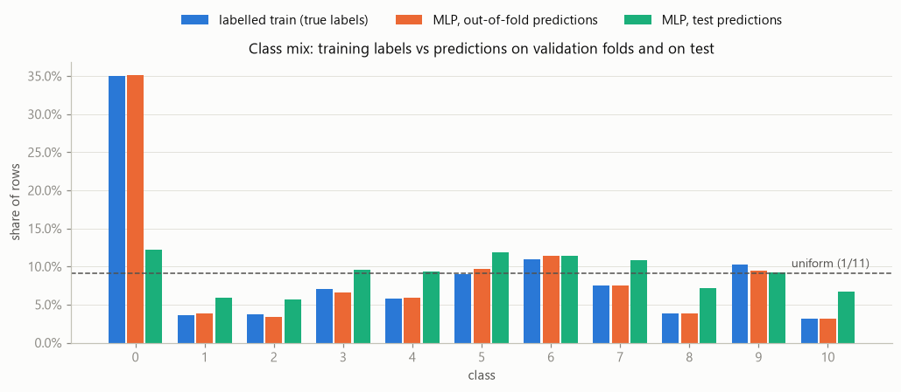
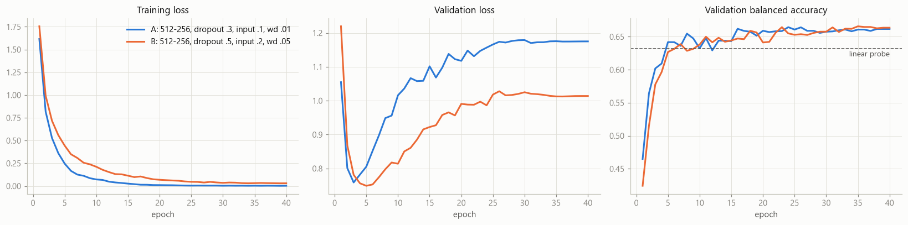
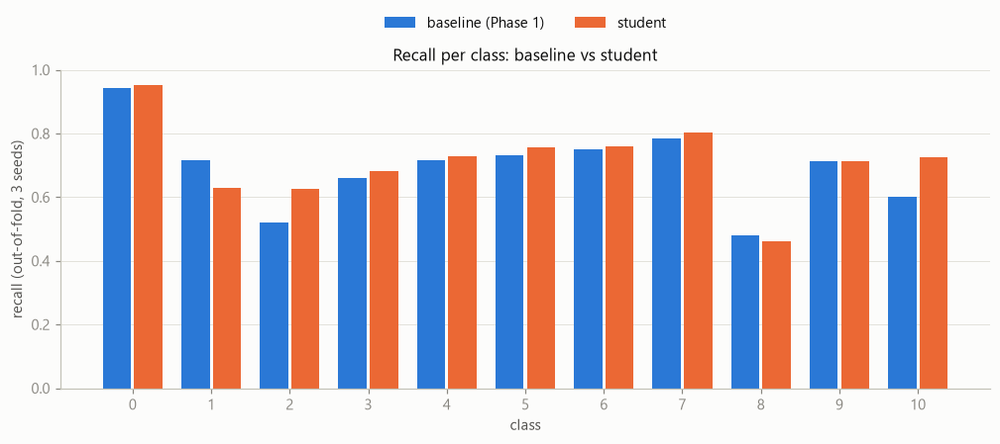

# IE643 Programming Challenge 2026: Report

**Name / roll number:** _<fill in>_   **Kaggle account:** _<fill in>_
**Final submission:** `phase3_student_all_channels.csv`. Kaggle public score **0.6619**; CV balanced accuracy **0.708**.

---

## 1. Summary

The task is to classify 768-dimensional feature vectors into 11 classes. About 90% of the samples are flagged as
"deformed", 38% of the training rows are unlabelled, and 384 extra "supplementary" features are given for training
rows only. Only MLPs and CNNs are allowed.

The final model is a **student MLP trained by generalized distillation**. A teacher MLP on the supplementary features
passes its knowledge to the student, which sees only the main features. It does so through three channels:
1. soft pseudo-labels on the unlabelled rows;
2. out-of-fold soft labels on the labelled rows;
3. an auxiliary head that reconstructs the supplementary features.

Every loss term uses **logit adjustment**, because the labels are imbalanced and the test set has a different class
mix. The submission averages 5 student MLPs.

| Stage | CV balanced acc. | CV acc. | Kaggle |
|---|---|---|---|
| Linear probe (diagnostic) | 0.632 | 0.775 | — |
| Phase 1: MLP, logit-adjusted loss | 0.682 | 0.775 | 0.6165 |
| **Final: distilled student** | **0.708** | **0.792** | **0.6619** |

---

## 2. Data analysis

Notebook: `eda_deformed.ipynb`.

### 2.1 Composition
- 2076 training rows: 1284 labelled and 792 unlabelled. 490 test rows.
- **90.0% of the training rows are deformed**, and only 136 labelled rows are clean. The deformed share is about the same in every class (80–95%), so the flag is not tied to the class.
- **The labels are imbalanced:** class 0 is 35% of the labelled rows, while classes 1, 2, 8 and 10 have only 40–50 rows each.

### 2.2 What "deformed" means
The host defines it only as "corrupted or deformed". The features look like embeddings from a frozen pretrained encoder
(768-d, row norm ≈ 12–13). Deformed vectors show the usual signs of a corrupted input:
- **shorter:** mean row norm 12.57 vs 13.11;
- **less spread:** the per-feature spread shrinks for 95% of the features, with a median ratio of 0.78;
- **shifted:** 120 of the 768 features move by more than one pooled standard deviation;
- **crowded together:** nearest-neighbour cosine 0.973 vs 0.958.

The class signal survives but weakens: a linear probe reaches 0.87 accuracy on clean rows vs 0.72 on deformed rows.

### 2.3 The test set is also ~90% deformed
Four independent checks agree:
- a deformation detector (0.96 balanced accuracy) classifies 90.6% of test rows as deformed;
- the test mean lies next to the deformed mean (distance 0.64, vs 2.85 to the clean mean);
- 93.5% of test rows have a deformed nearest training neighbour;
- a train-vs-test classifier reaches only AUC 0.58.

**So the 90% is the real data distribution, not an imbalance to correct.** We never rebalance clean vs deformed rows.

### 2.4 A hard "far group" of deformed rows
A tight group of deformed rows sits apart from everything else in PCA space: 225 training rows, all deformed, and 11.2%
of the test rows. Its class mix matches the other deformed rows, so it is a *kind or severity* of deformation, not a
class. These are the hardest rows: a linear probe gets 0.58 on them, vs 0.78 on the other deformed rows and 0.93 on
clean rows.

### 2.5 The supplementary features
The 384 supplementary features G are **much more informative** than the 768 main features E: a linear probe scores
0.851 vs 0.774. They are also **less affected by deformation**: the detector reaches 0.85 on G vs 0.96 on E. But G
exists only for training rows, so it cannot be an input at test time. That makes it *privileged information*.

### 2.6 Label shift between training and test
Models that reproduce the training class mix on validation folds (class 0: 35.1% predicted vs 35.0% true) predict
class 0 for only **12.2%** of test rows. An independent linear probe shows the same drop. Test predictions are much
closer to uniform than to the training mix. **The test set very likely has far fewer class-0 rows**, possibly close to
balanced.

The leaderboard agrees. Our Phase 1 model scored 0.6165 on Kaggle, far below its CV plain accuracy (0.775) and closer
to its CV balanced accuracy (0.682). So we optimize balanced accuracy.

---

## 3. Validation protocol (Phase 0)

- **Groups:** each training row is `clean`, `deformed` or `far` (Section 2.4).
- **Folds:** 5 folds over the labelled rows, stratified on class × group, saved once (`folds/cv_folds_v1.json`) and reused by every experiment. Unlabelled rows are never scored.
- **Metrics:** balanced accuracy (main metric, our stand-in for the hidden-weight accuracy), plain accuracy, and accuracy per group.
- **Noise:** the fold-to-fold std of balanced accuracy is about 0.03. Comparisons therefore use 3 seeds × 5 folds and *run-by-run (paired)* differences with standard errors.

---

## 4. Method

### 4.1 Base network and loss (Phase 1)
- **Network:** `standardize → Dropout(0.2) → Linear(768, 512) → GELU → Dropout(0.5) → Linear(512, 256) → GELU → Dropout(0.5) → Linear(256, 11)`.
- **Training:** AdamW (learning rate 1e-3, weight decay 0.05), batch size 64, 40 epochs with cosine decay, no early stopping.
- **Loss: logit-adjusted cross-entropy** (Menon et al., 2021), i.e. cross-entropy on `logits + τ·log(prior)` with τ = 1, predicting with the raw logits. Its scores assume a uniform class prior, which suits both the balanced metric and the shifted test mix.

Six regularization settings gave the same result (0.652–0.664 balanced accuracy): the networks overfit within a few
epochs whatever the setting. **The bottleneck is information, not capacity.**

| Loss (3 seeds × 5 folds) | Balanced acc. | Acc. |
|---|---|---|
| Cross-entropy | 0.657 | 0.775 |
| Class-weighted cross-entropy | 0.679 | 0.775 |
| **Logit-adjusted cross-entropy** | **0.682** | **0.775** |

Logit adjustment beats plain cross-entropy by +0.026 run by run, in 14 of 15 runs. The gain comes from the rare
classes; for example, class 10 recall rises from 0.50 to 0.60.

### 4.2 Generalized distillation from the supplementary features (Phases 3–4)
This is learning using privileged information (Vapnik & Vashist, 2009) via generalized distillation (Lopez-Paz et al.,
2016).
- **Teacher:** the same MLP and loss, trained on G (0.832 balanced accuracy in CV). Adding E to the teacher made it worse (0.808).
- **Student:** the same MLP on E with a second linear head (256 → 384). It is trained on all 2076 training rows with four loss terms, each weighted by its share of the mini-batch:

| Term | Rows | Target | Weight |
|---|---|---|---|
| Logit-adjusted cross-entropy | labelled | true label | 1 |
| Soft cross-entropy (channel 2) | labelled | **out-of-fold** teacher distribution, T = 2 | λ_lab = 1 |
| Soft cross-entropy (channel 1) | unlabelled | teacher distribution, T = 2 | λ = 2 |
| Mean squared error (channel 3) | all | standardized G | β = 1 |

**Prior consistency.** The unlabelled rows follow the training mix (the teacher labels 39% of them class 0). A soft loss
without logit adjustment therefore pulls the student back towards class 0, and our first attempt lost balanced accuracy
this way. The fix is the same prior shift in every soft loss: `softmax(student_logits + shift)` is matched to
`softmax((teacher_logits + shift) / T)`. Then all terms train the raw logits as uniform-prior scores.

**Leakage control.** For validation fold k, every teacher is trained without fold k's labels. The out-of-fold teachers
for channel 2 are nested: for fold k and each other fold j, they are trained without both k and j.

### 4.3 Final model
Implemented in `ie643/distill.py: fit_final` and run by `scripts/train_final.py`:
- 3 teacher seeds on G of all labelled rows label the unlabelled rows;
- out-of-fold teacher logits (fixed folds, 3 seeds) label the labelled rows;
- 5 student seeds are trained on all rows;
- the test prediction is the argmax of the averaged student probabilities.

---

## 5. Results

**Distillation, channel by channel** (1 seed; baseline 0.691 at the same seed):

| Student | Balanced acc. | Paired vs baseline |
|---|---|---|
| Pseudo-labels, no prior shift | 0.681 | −0.010 |
| Pseudo-labels | 0.699 | +0.008 |
| G-head only | 0.702 | +0.011 |
| Pseudo-labels + labelled-row distillation | 0.704 | +0.013 |
| **All three channels** | **0.707** | **+0.016** |

**Confirmation over 3 seeds × 5 folds:**

| | Balanced acc. | Acc. | Clean / deformed / far |
|---|---|---|---|
| Baseline | 0.682 | 0.775 | 0.927 / 0.781 / 0.592 |
| **Student** | **0.708** | **0.792** | **0.949 / 0.800 / 0.595** |

- The student is +0.026 run by run (standard error 0.010), higher in 12 of 15 runs.
- On Kaggle it scored **0.6619**, up from 0.6165. The leaderboard gain (+0.045) was larger than the CV gain, so CV improvements carried over.

---

## 6. Other methods tried

Each was tested on the same folds; scripts and logs are in `experiments/`.

| Method | Result | Used? |
|---|---|---|
| Bigger, wider, longer-trained or less regularized MLPs | Within noise or worse | No |
| Class-weighted cross-entropy | 0.679, slightly below logit adjustment | No |
| Post-hoc extra prior correction at prediction time | Inconsistent on CV | No |
| Teacher on E + G instead of G | 0.808 vs 0.832 | No |
| Hard pseudo-labels with a confidence threshold of 0.7 | 0.679 vs 0.687 for soft labels (both before the prior fix, 1 seed) | No |
| Student tuning: β = 3 (heavier G-head) | +0.005 CV (se 0.004); Kaggle 0.6512 | No: gain within noise |
| Student tuning: β = 3, τ = 1.5 | +0.007 CV, but −0.015 accuracy and −0.045 far group; Kaggle 0.6616 | No |
| **Self-training on the test rows** (transductive) | Worse: −0.007 to −0.012 | **No.** We also chose not to train on test inputs, on principle |
| Classifying through G predicted from E | 0.657–0.667, below the student | No |
| Hard labels for the 72 clean unlabelled rows, from PCA + logistic regression (teammate's analysis) | No gain (−0.002 to −0.004) | No |

**Why the far group stays hard.** A linear map from E predicts G with mean R² 0.47 overall, but only **0.05 inside the
far group**. In those rows the deformation has destroyed the information that G carries. That explains why no channel
improved the far group (0.59), even though the teacher reaches 0.795 there.

---

## 7. Key design decisions

1. **Balanced accuracy as the target.** This follows from the hidden class weights, the label shift and the leaderboard behaviour.
2. **Keep the clean/deformed mix as it is.** The test set has the same 90/10 mix.
3. **Logit adjustment in every loss term.** This keeps all terms consistent with a uniform-prior prediction.
4. **Use the supplementary features as a teacher, not an input.** They are training-only.
5. **Fixed, stratified folds and paired multi-seed comparisons.** Most single-seed differences were noise.
6. **Fully inductive final model.** It is trained on training data only.

## 8. Limitations and possible improvements

- The far group (about 11% of test) is at about 0.60 accuracy. Its main features carry little class information, which limits any E-only model.
- The student captures only part of the teacher's advantage (0.708 vs 0.832). Most of what G knows is not predictable from E.
- Not tried for lack of time:
  - mixup or noise augmentation in feature space;
  - normalizing each row to unit length (cosine geometry);
  - deformation-aware mixtures of experts;
  - ensembles of differently configured students.

## 9. Reproducibility

See `README.md`. The final submission is regenerated exactly by
`python scripts/train_final.py --beta 1 --tau 1 --teacher-seeds 3 --student-seeds 5 --name final_phase3` (about 4
minutes on CPU). The weights are in `checkpoints/phase3_student/`.

## 10. Collaboration and tools

- AI assistance (Claude) was used for analysis, code and writing, which the challenge instructions allow.
- _<Describe any collaboration here, e.g. the teammate's PCA analysis and pseudo-labels in Section 6, which are not part of the final model.>_

## References

- G. Hinton, O. Vinyals, J. Dean. Distilling the Knowledge in a Neural Network. 2015.
- V. Vapnik, A. Vashist. A new learning paradigm: Learning using privileged information. *Neural Networks*, 2009.
- D. Lopez-Paz, L. Bottou, B. Schölkopf, V. Vapnik. Unifying distillation and privileged information. *ICLR*, 2016.
- A. K. Menon et al. Long-tail learning via logit adjustment. *ICLR*, 2021.
- D.-H. Lee. Pseudo-Label: a simple and efficient semi-supervised learning method. *ICML Workshop*, 2013.
- M. Saerens, P. Latinne, C. Decaestecker. Adjusting the outputs of a classifier to new a priori probabilities. *Neural Computation*, 2002.
